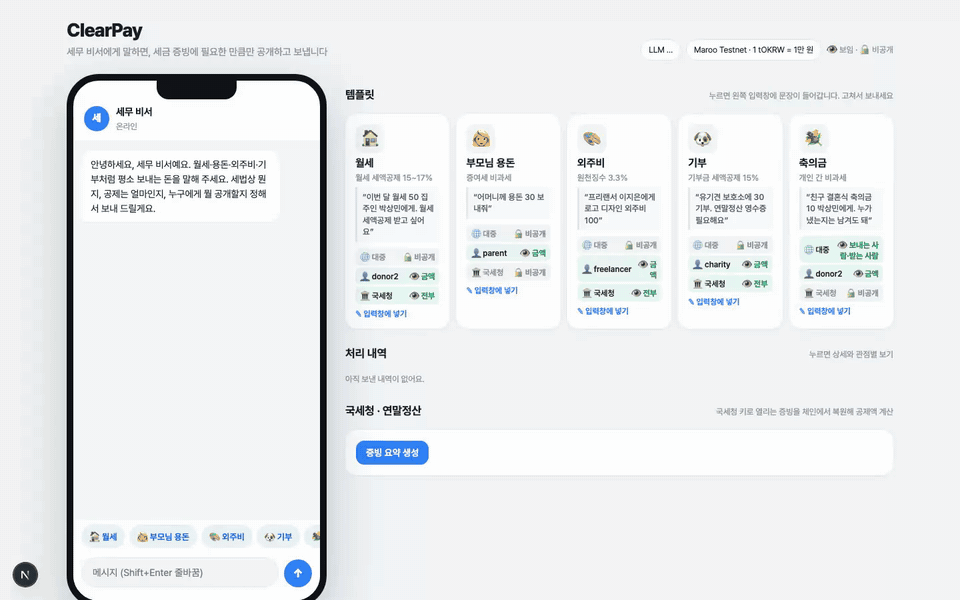
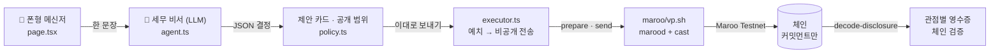

<p align="center">
  
</p>

<h1 align="center">ClearPay</h1>
<p align="center"><b>세금은 챙기고, 금액은 숨기고.</b><br/>세금 생각만 하면 머리 아픈 보통 사람을 위해, AI가 알아서 공제를 챙기고 꼭 알아야 할 상대에게만 내용을 공개하는 송금비서</p>
<p align="center">
  <a href="docs/demo.mp4">▶ 60초 데모 영상</a> ·
  <a href="#빠른-시작">빠른 시작</a> ·
  <a href="#아키텍처">아키텍처</a>
</p>
<p align="center">
  
  
  
</p>

---

## 누구의 어떤 문제인가

월세를 내고, 어머니께 용돈을 보내고, 프리랜서에게 외주비를 주고, 보호소에 기부합니다. 전부 평범한 송금인데 **세금은 하나도 평범하지 않습니다.**

| 보내는 돈 | 보통 사람이 막히는 지점 | 그래서 생기는 일 |
|---|---|---|
| 월세 | 세액공제가 되는 건 알지만 증빙을 어떻게 남기는지 모름 | 공제를 놓치거나, 집주인 소득이 드러나 현금을 요구받음 |
| 외주비 | 3.3%를 떼야 한다는데 얼마를 보내야 하는지 헷갈림 | 지급명세서 누락, 단가가 거래처·경쟁사에 노출 |
| 기부 | 영수증은 필요한데 이름과 금액이 공개되는 건 싫음 | 소액 기부도 망설임 |
| 용돈·경조사비 | 신고 대상인지조차 모름 | 불필요한 걱정, 또는 기록 없음 |

기존 수단에는 빈틈이 있습니다. 계좌이체는 **세금 증빙이 어렵고**, 공개 블록체인은 **전 세계에** 보이며, 프라이버시 체인은 반대로 증빙을 남길 수 없습니다.

## ClearPay가 하는 일

한 문장으로 말하면, 세무 비서가 **세법 분류 → 예상 공제 → 누구에게 무엇을 공개할지**를 정하고 돈을 보냅니다.

```
"이번 달 월세 50만 원 집주인에게. 세액공제 받고 싶어요."

  세법      월세 세액공제 15~17% · 예상 공제 75,000원
  공개 범위  국세청 ─ 금액·보내는 사람·받는 사람  (지정 키로만 복호화)
            집주인 ─ 금액
            대중   ─ 없음  (체인에는 커밋먼트만)
  실행      Maroo 테스트넷 예치 → 비공개 전송 (Groth16 증명, 10~25초)
```

| 사용자 | 얻는 것 |
|---|---|
| **보내는 사람** | 세법을 몰라도 공제를 챙기고, 내 송금 내역은 꼭 필요한 상대만 봄 |
| **받는 사람** (집주인·프리랜서·단체) | 자기 몫의 금액만 확인. 보낸 사람의 다른 정보는 받지 않음 |
| **국세청·세무대리인** | PDF 대신 체인에서 자기 키로 복호화한 위조 불가능한 증빙. 연말정산 요약 자동 생성 |
| **대중** | 단체의 집행(공개 출금)만 추적 가능. 개인 거래는 보이지 않음 |

## 왜 Maroo Verifiable Privacy인가

Maroo VP는 거래마다 두 개의 다이얼을 제공합니다. ClearPay는 이 다이얼을 사람이 아니라 AI가 돌리게 합니다.

| 다이얼 | 값 | 뜻 |
|---|---|---|
| `privacy-policy` | all-private · amount · to · amount-to · from · amount-from · from-to · amount-from-to | 공개 payload에 **무엇을** 담을지 |
| `disclosure-mode` | none · public · recipient-encrypted | 그 payload를 **누가** 읽을지 (아무도 · 누구나 · 지정 공개키 보유자만) |

체인 자체에는 금액·보내는 사람·받는 사람이 **절대** 기록되지 않습니다. 노트(UTXO) 커밋먼트와 널리파이어만 남고, 선택한 필드가 선택한 상대에게만 열립니다. 테스트넷에서 확인한 동작:

- 국세청 키로 `decode-disclosure` → 금액·당사자 복원 ✅ · 제3자 키 → `decryption failed` ✅
- `public` 모드 payload는 키 없이 누구나 디코드 ✅ (축의금 명부)
- 출금은 정확히 일치하는 노트가 필요(거스름돈 없음) → 자기전송으로 노트를 만든 뒤 출금(자동 처리)
- 증명 시간: 예치 0.2s · 전송 0.5s (Apple M-series, 로컬 증명)

## 데모 (60초)

<a href="docs/demo.mp4"></a>

1. 템플릿 **월세** → 입력창에 문장 → 전송. A.X K2가 2초 안에 제안 카드를 만듭니다.
2. **이대로 보내기** → 예치·증명·비공개 전송. Explorer 링크가 붙습니다.
3. 내역 클릭 → **대중 / 집주인 / 국세청 / 나** 입장별 영수증. 국세청 키로 체인에서 복원, 다른 키로는 거부.
4. **증빙 요약 생성** → 국세청이 체인에서 복원한 값으로 연말정산 공제액을 계산.

온체인 증거 (Maroo Testnet, chain 450815):

| 장면 | 거래 |
|---|---|
| 기부 30 · 국세청 지정 공개 | [예치](https://explorer-testnet.maroo.io/tx/0x8c8826b614841bef8c5c5211cb741b5dceb5f7b69dde710880723e8c0b7fb3fc) → [비공개 전송](https://explorer-testnet.maroo.io/tx/0x948a8212eb4239131fe6c257a2b466979104ce49adde656b609369fd2546298d) |
| 월세 50 · 국세청 지정 공개 | [비공개 전송](https://explorer-testnet.maroo.io/tx/0x8260314d960029c303d5189c3dbcb641b25e1debe32a7f54ffa07f463a9faa65) |
| 축의금 50 · 명부 공개(from-to public) | [비공개 전송](https://explorer-testnet.maroo.io/tx/0xc0899302ebb5fcd55eda23be018d383fb707010ef9591e8aaf0770ece3799aca) |
| 금액 공개(amount-to public) | [비공개 전송](https://explorer-testnet.maroo.io/tx/0xc791d87d313130c6f4c4ab050451870a2fafd24ba23ae67c9767b2d93e248832) |
| 단체 집행 · 공개 출금 10 | [자기전송](https://explorer-testnet.maroo.io/tx/0x2950b26baf02dc300e8479b669e3b1b5760edd31c2aa36c749b2eee5ae931b26) → [출금](https://explorer-testnet.maroo.io/tx/0x9d0a0905184171b1d4b08990080f71fe210a3c735a25b5fff4334c6c4dca0457) |

## 빠른 시작

```bash
# macOS 26+ (Apple Silicon) 또는 Linux x86-64/arm64 · Node 20+ · pnpm · jq · Foundry cast
brew install foundry jq
git clone https://github.com/chanpark-xyz/clearpay && cd clearpay
cp .env.example .env.local        # LLM_API_KEY, (선택) WALLET_*_KEY
bash maroo/setup.sh               # marood v0.11.1 + 증명 파일 설치, 지갑 준비, 주소 출력
#   faucet.maroo.io → donor1 주소로 2,000 tOKRW 이상
bash maroo/setup.sh attest        # 송신 지갑 EAS attestation (최초 1회)
pnpm install && pnpm dev --port 3077
```

### 설정 (`.env.local`)

| 키 | 설명 |
|---|---|
| `LLM_PROVIDER` `LLM_BASE_URL` `LLM_MODEL` `LLM_API_KEY` | AI. 기본 SKT A.X K2(OpenAI 호환 JSON 모드). 키가 비면 규칙 모드, `codex`면 로컬 Codex CLI |
| `WALLET_DONOR1_KEY` … `WALLET_TAXOFFICE_KEY` | 지갑 개인키(0x…). 비우면 setup.sh가 테스트 키를 생성해 저장소 밖에 둠 |
| `VP_DIR` | marood·증명 파일·키링 위치 (기본 `../maroo-privacy-testnet`) |

역할: `donor1` 보내는 사람(잔액 필요) · `donor2` 집주인 · `parent` 어머니 · `freelancer` 프리랜서 · `charity` 기부단체 · `taxoffice` 국세청(증빙 복호화 키)

## 아키텍처



| 경로 | 역할 |
|---|---|
| `src/lib/agent.ts` | 세무 비서. 세법 규칙(기부 15/30%, 월세 15~17%, 원천징수 3.3%, 증여 5천만, 경조사 20만)을 프롬프트에 명시. 프로바이더 `api`(A.X K2/OpenAI) · `codex` · `rules` |
| `src/lib/policy.ts` | `DisclosureProfile` = privacy-policy × disclosure-mode × 수신 키 |
| `src/lib/executor.ts` | 잔액 확인 → 예치 → 비공개 전송(플래그 적용) · 출금 |
| `src/app/api/*` | `chat` `execute` `decode` `receipt` `withdraw` `state` |
| `maroo/vp.sh` | marood v0.11.1 래퍼: `addr balance pool attest deposit transfer withdraw notes dpubkey decode txinfo import` |
| `maroo/setup.sh` | 새 머신 세팅 (도구·지갑·EAS) |

### 보안 원칙
- 개인키와 AI 키는 `.env.local`(git 제외) 또는 저장소 밖 키링에만 존재합니다.
- 브라우저로 나가는 것은 주소·잔액·노트 합계·복호화된 필드·tx 해시뿐입니다. 노트 원문과 CLI 로그는 서버 밖으로 나가지 않습니다.
- 실서비스에서는 서버 서명 대신 EIP-712 `*WithAuthorization` 릴레이로 사용자 서명을 받습니다.

## 기술 스택
SKT A.X K2 API · Maroo Testnet · Maroo Verifiable Privacy (marood) · Maroo EAS · Foundry cast · viem · Next.js 16 · TypeScript · OpenAI SDK

---
<p align="center">OBA.RUN Season 2 · 2026-11-07 · Hashed Lounge</p>
